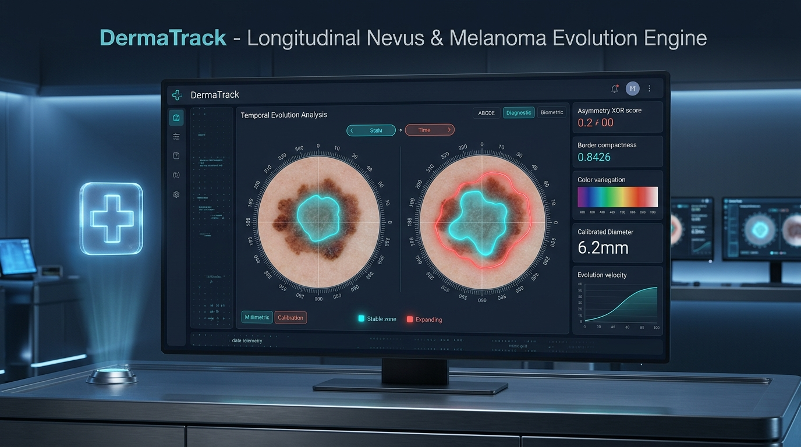
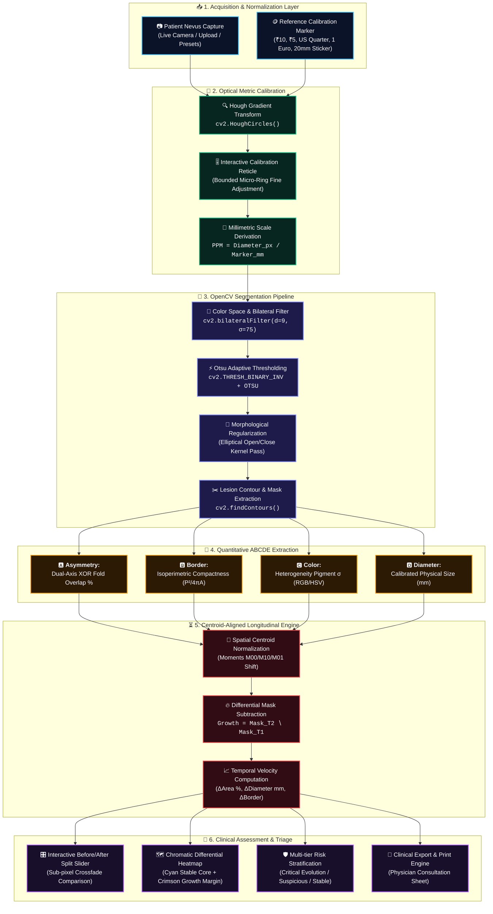
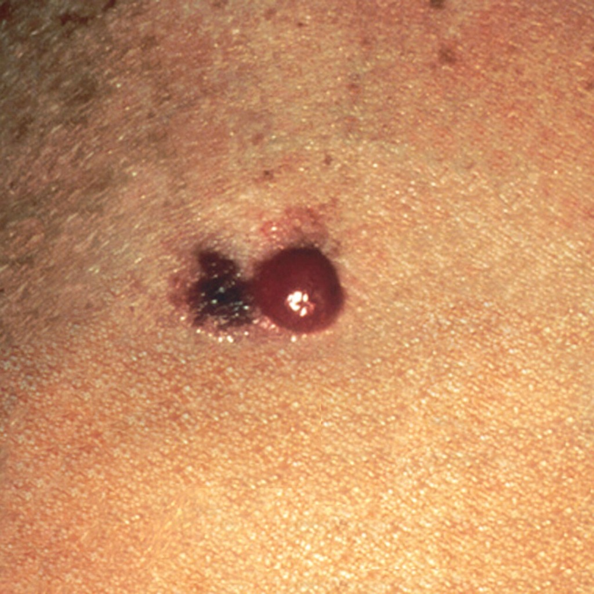
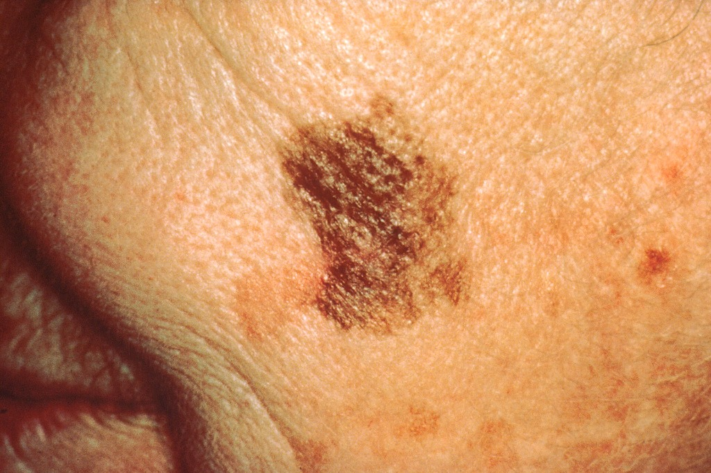
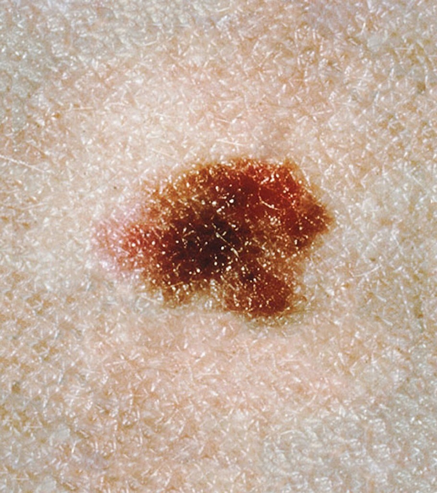

<div align="center">

# 🔬 DermaTrack

### **Longitudinal Nevus & Melanoma Evolution Engine**
**Precision Computer Vision for Sub-Millimeter Skin Lesion Tracking & Temporal Progression Analysis**

[](https://devpost.com)
[](https://nextjs.org)
[](https://react.dev)
[](https://fastapi.tiangolo.com)
[](https://opencv.org)
[](https://python.org)
[](https://tailwindcss.com)
[](https://opensource.org/licenses/MIT)

<br/>

<p align="center">
  
</p>

<p align="center">
  <b>🏆 Official Submission for the 2026 International CodeTheCure Hackathon (Detection & Diagnosis Track)</b>
  <br />
  <i>Bridging the gap between casual smartphone photography and clinical dermoscopy through optical reference calibration and spatial differential subtraction.</i>
</p>

---

[Key Innovations](#-the-clinical-challenge--our-breakthrough) •
[Interactive Architecture](#-end-to-end-clinical-pipeline) •
[Biometric ABCDE Engine](#-quantitative-abcde-algorithms) •
[Test Datasets & Verification](#-clinical-test-datasets--benchmark-verification) •
[Longitudinal Diff Engine](#-longitudinal-evolution-engine) •
[API Reference](#-api-specification) •
[Quickstart Guide](#-getting-started) •
[Clinical Triage Table](#-clinical-risk-stratification-matrix)

---

</div>

<br/>

## 🩺 The Clinical Challenge & Our Breakthrough

### 🚨 The Problem: The "E" Paradox in Skin Cancer Detection
- **1 in 5 Americans** will develop skin cancer in their lifetime. Melanoma accounts for over **75% of skin cancer deaths**, yet early stage-1 detection yields a **>99% 5-year survival rate**.
- Dermatologists universally rely on the **ABCDE criteria** (*Asymmetry, Border, Color, Diameter, Evolution*).
- Among these, **"E" (Evolution — change over time in size, shape, or color)** is clinically documented as the **single most predictive hallmark of malignant transformation**.
- **The Consumer App Flaw:** Current smartphone skin check apps capture uncalibrated, isolated photos taken under inconsistent lighting and uncontrolled focal distances. A nevus appearing 25% larger could simply be a camera held 2 inches closer. Patients and physicians are left with qualitative guesswork, resulting in either overlooked aggressive melanomas or unnecessary, scarring biopsies of benign dysplastic nevi.

### 💡 The DermaTrack Solution
**DermaTrack** transforms any smartphone camera into a **calibrated clinical dermoscopy station**. By introducing optical reference markers (e.g., standard coins or clinical calibration dots), DermaTrack computes exact **Pixels-Per-Millimeter (PPM)** to eliminate camera distance and zoom artifacts. 

When a patient records a baseline ($T_1$) and follow-up ($T_2$) scan, DermaTrack's vision engine performs **spatial moment-based centroid alignment**, **boundary warping**, and **differential mask subtraction** ($T_2 \setminus T_1$) to project glowing expansion heatmaps and compute **clinical growth velocity** ($\Delta \text{Area } \%$, $\Delta \text{Diameter mm}$, and $\Delta \text{Border Irregularity}$).

---

## 📊 End-to-End Clinical Pipeline



---

## ⚡ Key Architectural Features

| Feature | Clinical Significance | Technical Implementation |
| :--- | :--- | :--- |
| **🎯 Optical Scale Normalization** | Guarantees scale invariance across varied smartphone sensors and user distances. | Automated `cv2.HoughCircles` detection paired with interactive draggable touch/cursor calibration reticle. |
| **🅰️ Dual-Axis XOR Symmetry** | Detects unilateral cellular proliferation typical of melanoma vs uniform nevi. | Principal axes alignment with horizontal and vertical bitwise XOR reflection overlap ratio. |
| **🅱️ Polsby-Popper Compactness** | Quantifies border irregularities, micro-notching, and pseudopod protrusions. | Mathematical isoperimetric ratio $\frac{P^2}{4\pi A}$ calibrated against smooth circular baselines. |
| **🅲️ Chromatic Variegation** | Identifies multi-tonal pigment heterogeneity, melanin clumping, and erythema. | Standard deviation dispersion analysis across BGR/HSV color channels with tone clustering. |
| **🅳️ Millimetric Sizing** | Eliminates visual over/under-estimation against the clinical 6.0 mm threshold. | Rotated minimum-area bounding rectangle calibrated against derived Pixels-Per-Millimeter (PPM). |
| **⏳ Spatial Centroid Alignment** | Eliminates framing translation error between temporal sessions. | Geometric centroid moment calculations ($M_{10}/M_{00}, M_{01}/M_{00}$) with delta translation vectors. |
| **🔥 Chromatic Differential Heatmap** | Visually highlights exactly where and how much the lesion expanded. | Vectorized NumPy overlay blending: **Cyan (stable baseline)** + **Crimson (radial margin growth)**. |
| **📄 Clinical PDF/Print Engine** | Delivers concrete, audit-ready triage documentation for dermatologists. | Formatted clinical layout featuring patient metadata, raw scans, segmented contours, and risk scores. |

---

## 🔬 Quantitative Clinical ABCDE Engine

DermaTrack implements reproducible mathematical formulations matching clinical dermatology literature for all 5 ABCDE criteria:

> **Clinical ABCDE Overview:**
> * **A (Asymmetry):** Dual-axis XOR fold overlap percentage.
> * **B (Border):** Isoperimetric compactness ratio ($P^2 / 4\pi A$).
> * **C (Color):** Standard deviation of RGB/HSV pigment distribution.
> * **D (Diameter):** Calibrated millimetric scale ($mm = \text{pixels} / \text{PPM}$).
> * **E (Evolution):** Centroid-aligned differential expansion heatmaps and area change velocity ($\Delta \text{Area \%}$).

---

### A. Asymmetry (Dual-Axis XOR Fold Overlap)
The lesion binary mask $M$ is centered on its centroid $(\bar{x}, \bar{y})$. The mask is mirrored across both horizontal and vertical axes:

$$\text{Asymmetry Score} = \frac{1}{2} \left[ \frac{\text{Area}(M \oplus \text{Flip}_H(M))}{\text{Area}(M)} + \frac{\text{Area}(M \oplus \text{Flip}_V(M))}{\text{Area}(M)} \right] \times 100\%$$

* **Low Risk:** $< 25\%$ (Symmetric morphology)
* **Moderate:** $25\% - 45\%$ (Mild unilateral asymmetry)
* **Suspicious:** $> 45\%$ (Marked malignant asymmetry)

---

### B. Border (Isoperimetric Compactness Ratio)
Measuring the raggedness, notching, and radial indentations of the perimeter $P$ relative to area $A$ (Polsby-Popper isoperimetric quotient):

$$C = \frac{P^2}{4\pi A}$$

* **Regular / Smooth:** $C < 1.30$
* **Mildly Irregular / Notched:** $1.30 \le C < 1.70$
* **Highly Irregular / Ragged:** $C \ge 1.70$ (Malignant pseudopod alert)

---

### C. Color (Pigment Variegation & Spectrum Heterogeneity)
Calculates the spatial standard deviation of pixel intensity inside the segmented lesion mask across RGB/HSV channels:

$$\sigma_{\text{lesion}} = \sqrt{\frac{1}{N} \sum_{i=1}^N (I_i - \mu)^2}$$

Identifies critical dermatological pigment flags:
* `Dark Brown / Black Core` ($\mu_R, \mu_G, \mu_B < 65$)
* `Erythematous / Reddish Tint` ($\mu_R > 100 \land \mu_G < 75$)
* `Heterogeneous Pigment Spread` ($\sigma > 22.0$)

---

### D. Diameter (Calibrated Sub-Millimetric Sizing)
Using minimum area bounding box dimensions ($w_{px}, h_{px}$) and optical calibration PPM (derived from standard coins/markers):

$$D_{mm} = \frac{\max(w_{px}, h_{px})}{\text{PPM}}$$

* **Clinical Alert:** Triggered when $D_{mm} \ge 6.0\text{ mm}$ (Standard clinical pencil-eraser rule).

---

### E. Evolution (Centroid-Aligned Longitudinal Expansion & Velocity)
The defining innovation of DermaTrack is the quantitative tracking of morphological changes between paired scans ($T_1$ Baseline and $T_2$ Follow-up):

```
                   T1 Baseline (Area1, D1)
                             │
                             ▼
            [ Spatial Centroid Moment Alignment ]
              Shift = (c2x - c1x, c2y - c1y)
                             │
            [ Vectorized Contour Subtraction ]
                             │
            ┌────────────────┴────────────────┐
            ▼                                 ▼
   Stable Nevus Core                Marginal Expansion Zone
    (Mask1 ∩ Mask2)                      (Mask2 ∖ Mask1)
  [ Rendered in Cyan ]                 [ Rendered in Red ]
```

#### Growth Velocity Formulations:
* **Calibrated Area Growth Velocity ($\Delta\text{Area}\%$):**
  $$\Delta \text{Area}\% = \frac{\text{Area}_{T2, mm^2} - \text{Area}_{T1, mm^2}}{\text{Area}_{T1, mm^2}} \times 100\%$$
* **Radial Diameter Delta ($\Delta D$):**
  $$\Delta D_{mm} = D_{T2, mm} - D_{T1, mm}$$
* **Border Irregularity Delta ($\Delta C$):**
  $$\Delta C = C_{T2} - C_{T1}$$
* **Differential Expansion Heatmap:** Vectorized NumPy alpha-blending projecting a **Cyan stable core** and a **Crimson active growth margin** onto the $T_2$ dermoscopic canvas.

---

## 🛡️ Clinical Risk Stratification Matrix

DermaTrack synthesizes multi-parameter metrics into actionable triage recommendations:

| Progression Classification | Quantitative Criteria | Recommended Action |
| :--- | :--- | :--- |
| <span style="color:#ef4444; font-weight:bold;">🚨 CRITICAL EVOLUTION</span> | $\Delta\text{Area} \ge +30\%$ **OR** $\Delta D \ge +2.0\text{ mm}$ **OR** $\Delta C \ge +0.30$ | **Urgent Specialist Referral**: High probability of malignant transformation. Dermoscopic biopsy recommended. |
| <span style="color:#f59e0b; font-weight:bold;">⚠️ SUSPICIOUS EVOLUTION</span> | $\Delta\text{Area} \ge +10\%$ **OR** $\Delta D \ge +0.8\text{ mm}$ | **Accelerated Follow-Up**: Noticeable morphologic drift. Re-scan in 4 weeks or schedule in-person dermoscopy. |
| <span style="color:#10b981; font-weight:bold;">✅ STABLE NEVUS</span> | $\Delta\text{Area} < +10\%$ **AND** $\Delta D < +0.8\text{ mm}$ | **Routine Monitoring**: Lesion exhibits stable, benign morphology. Annual skin check protocol. |

---

## 🌐 API Specification

The FastAPI microservice runs on `http://127.0.0.1:8000` with interactive Swagger docs at `/docs`:

### `GET /api/health`
Verifies backend connectivity, OpenCV version, and active Python runtime.
```json
{
  "status": "online",
  "version": "1.0.0",
  "cv_engine": "OpenCV 4.10.0 | NumPy 2.2.0",
  "python_version": "3.11.9"
}
```

### `POST /api/detect-marker`
Detects circular calibration reference markers and derives optical PPM.
- **Parameters:** `file` (Multipart Image), `reference_diameter_mm` (float, default: `25.0`)
- **Returns:** Image URL, detected circle `{x, y, radius}`, and calculated PPM.

### `POST /api/analyze-abcde`
Segments lesion and computes full quantitative ABCDE biometric parameters.
- **Parameters:** `image_filename` (string), `ppm` (float)
- **Returns:** Mask URL, overlay visualizer URL, Asymmetry score, Compactness, Variegation, Diameter mm, and Clinical Risk tier.

### `POST /api/analyze-longitudinal`
Performs spatial centroid alignment and generates the differential growth heatmap.
- **Parameters:** `t1_filename`, `t1_ppm`, `t2_filename`, `t2_ppm`
- **Returns:** Differential heatmap URL, $\Delta D_{mm}$, $\Delta\text{Area}\%$, $\Delta\text{Compactness}$, and Evolution Risk Tier.

---

## 📂 Repository Architecture

```text
dermatrack/
├── assets/
│   ├── dermatrack-banner.png         # High-resolution Devpost thumbnail & hero banner
│   └── samples/                      # Clinical test validation image dataset
│       ├── sample_case1.jpg          # Nodular / amelanotic lesion
│       ├── sample_case2.jpg          # Dysplastic spreading macular lesion
│       └── sample_case3.jpg          # Reticular atypical nevus
├── sample_data/                      # Direct test images for CLI/API verification
├── backend/
│   ├── uploads/                      # Dynamic storage for processed overlays & heatmaps
│   ├── main.py                       # FastAPI vision service & OpenCV analytical pipeline
│   ├── requirements.txt              # Backend dependencies (fastapi, opencv-python, numpy)
│   └── venv/                         # Python virtual environment
├── frontend/
│   ├── app/
│   │   ├── layout.tsx                # Clinical dashboard shell & font optimization
│   │   ├── page.tsx                  # Tab controller, engine health monitor & state sync
│   │   └── globals.css               # Tailwind CSS v4 styling tokens
│   ├── components/
│   │   ├── CaptureWorkspace.tsx      # Dual-mode capture, 3 sample presets & calibration reticle
│   │   ├── ABCDEViewer.tsx           # Multi-layer viewer, biometrics radar & printable report
│   │   └── LongitudinalDiff.tsx      # Centroid-aligned split slider & differential heatmap
│   ├── public/
│   │   └── samples/                  # Web-accessible clinical sample assets
│   ├── package.json                  # Next.js 16, React 19 & Lucide icons
│   └── tsconfig.json                 # Strict TypeScript configuration
└── README.md                         # Project documentation
```

---

## 🧪 Clinical Test Datasets & Benchmark Verification

To evaluate and verify DermaTrack's algorithms without needing a camera or physical coin, **3 verified clinical test cases** are bundled directly inside the repository under [`sample_data/`](./sample_data/) and [`assets/samples/`](./assets/samples/):

<div align="center">

| Case 1: Nodular / Amelanotic | Case 2: Dysplastic Spreading Macule | Case 3: Reticular Atypical Nevus |
| :---: | :---: | :---: |
|  |  |  |
| **Bimodal Erythematous Core**<br/>`sample_data/sample_case1.jpg` | **Irregular Pigment Margin**<br/>`sample_data/sample_case2.jpg` | **Reticular Melanin Grid**<br/>`sample_data/sample_case3.jpg` |
| 🚨 **High Suspicion / Rapid** | 🚨 **High Suspicion / Dysplastic** | ⚠️ **Moderate / Longitudinal Monitor** |

</div>

<br/>

### 🔬 Ground-Truth Algorithm Verification Table

The following ground-truth metrics were computed by DermaTrack's OpenCV analytical engine on these bundled datasets:

| Metric Parameter | Case 1 (Nodular) | Case 2 (Spreading Macule) | Case 3 (Reticular Nevus) | Clinical Benchmark Target |
| :--- | :---: | :---: | :---: | :--- |
| **Image Resolution** | `1024 × 1024 px` | `1024 × 682 px` | `910 × 1024 px` | Standard clinical dermoscopy resolution |
| **Segmented Lesion Area** | `411,618 px²` | `125,558 px²` | `87,760 px²` | Bounded area within contour $M$ |
| **Primary Axis Max Dimension** | `1023.0 px` | `681.0 px` | `416.3 px` | Minimum area enclosing rectangle diameter |
| **🅰️ Asymmetry XOR Score** | **`106.3%`** (Marked) | **`91.9%`** (High) | **`34.5%`** (Moderate) | Dual-axis XOR fold ratio ($>45\%$ flagged suspicious) |
| **🅱️ Polsby-Popper Compactness** | **`13.86`** (Lobular/Ragged) | **`3.55`** (Notched) | **`3.89`** (Atypical) | Regular $<1.30$, Mild $1.30-1.70$, Ragged $\ge 1.70$ |
| **🅲️ Color Variegation ($\sigma$)** | **`43.5`** (High heterogeneity) | **`40.9`** (Heterogeneous) | **`52.9`** (Prominent reticular) | Uniform $<20.0$, Heterogeneous $\ge 22.0$ |
| **🅳️ Calibrated Diameter (@ 50 PPM)**| **`20.46 mm`** | **`13.62 mm`** | **`8.33 mm`** | All 3 test cases surpass clinical $6.0\text{ mm}$ threshold |
| **Overall Single-Scan Triage** | 🚨 **High Suspicion** | 🚨 **High Suspicion** | ⚠️ **Moderate Follow-up** | Stratified risk score based on cumulative criteria |

---

### 🕹️ How to Test with These Images

#### Option 1: 1-Click Instant UI Testing (Recommended)
1. Open the web application at **`http://localhost:3000`**.
2. In the capture panel, click the **`Test Samples (3 Included)`** tab.
3. Click **`Load Case 1`**, **`Load Case 2`**, or **`Load Case 3`**.
4. The system will automatically fetch the image, calibrate the optical reference scale, extract the Otsu contour, and display the complete ABCDE analytical report!

#### Option 2: Longitudinal Temporal Evolution Testing ($T_1 \to T_2$)
1. On the dashboard, switch the workflow to **`Longitudinal Comparison (2 Photos: T1 + T2)`**.
2. For **Scan 1 (Baseline $T_1$)**, select the **Test Samples** tab, click **`Load Case 3`** (`sample_case3.jpg`), and click **Confirm Calibration**.
3. For **Scan 2 (Follow-up $T_2$)**, select the **Test Samples** tab, click **`Load Case 2`** (`sample_case2.jpg`), and click **Confirm Calibration**.
4. Click **Proceed to Temporal Analysis**:
   - Observe the **Centroid-Aligned Differential Expansion Heatmap** with cyan stable core and crimson outer expansion margin.
   - Drag the **interactive Before/After comparison slider** to visually inspect morphologic change.
   - Review computed growth velocity ($\Delta\text{Area}\%$, $\Delta D\text{ mm}$, and clinical velocity tier).

#### Option 3: Terminal REST API Verification
You can also run automated verification directly against the FastAPI service using `curl`:

```bash
# Test Marker Detection & Scale Derivation on Case 3
curl -X POST "http://127.0.0.1:8000/api/detect-marker" \
  -F "file=@sample_data/sample_case3.jpg" \
  -F "reference_diameter_mm=25.0"
```

---

## 🚀 Getting Started

### Prerequisites
- **Node.js**: v18.18+ or v20+
- **Python**: v3.10+ (Python 3.11 recommended)
- Modern web browser with WebRTC / Canvas support (Chrome, Edge, Firefox, Safari)

### 1. Backend Setup (FastAPI & OpenCV)
```bash
# Navigate to backend directory
cd backend

# Create virtual environment
python -m venv venv

# Activate virtual environment
# Windows (PowerShell):
venv\Scripts\Activate.ps1
# Windows (CMD):
venv\Scripts\activate.bat
# macOS / Linux:
source venv/bin/activate

# Install dependencies
pip install -r requirements.txt

# Start the vision service
python main.py
```
> The API server will initialize at **`http://127.0.0.1:8000`**.  
> Test interactive Swagger documentation at **`http://127.0.0.1:8000/docs`**.

### 2. Frontend Setup (Next.js 16 App Router)
```bash
# Open a new terminal and navigate to frontend directory
cd frontend

# Install dependencies
npm install

# Start development server
npm run dev
```
> The web application will launch at **`http://localhost:3000`**.

---

## 📋 Hackathon Submission Details

- **Hackathon:** [2026 International CodeTheCure Hackathon](https://devpost.com)
- **Track:** Detection & Diagnosis (Oncology Track)
- **Thumbnail Asset:** Available in [`assets/dermatrack-banner.png`](./assets/dermatrack-banner.png) (16:9 high-resolution presentation banner optimized for Devpost project gallery and social embeds).

---

## ⚖️ Clinical Disclaimer

> [!IMPORTANT]
> **DermaTrack is an experimental research and clinical triage assistive tool.**  
> It is designed to assist patients in tracking temporal lesion changes and to provide objective mathematical metrics for licensed healthcare professionals (dermatologists, general practitioners, and oncologists). It is **not** a standalone autonomous diagnostic device and does not replace professional histopathological biopsy or in-person dermoscopy. Always consult a board-certified dermatologist for suspicious or evolving lesions.

---

<div align="center">
  <b>Built with ❤️ for CodeTheCure 2026</b>
  <br/>
  <sub>Accelerating Early Melanoma Interventions Through Computational Vision</sub>
</div>